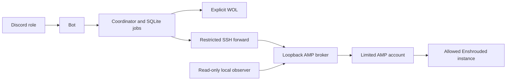

# Guildwake

**Wake your game night from Discord.**

An always-on Pi or Linux machine lets a Discord role check a sleeping AMP host,
wake it, and start Enshrouded through a restricted broker. The bot never receives
general SSH or AMP administrator access.

**Experimental source alpha — 0.1.0a1.** This configurable candidate has portable
and synthetic local tests. Independent installation, Linux service deployment,
ARM packaging and live wake/start of this exact candidate have **not** been
qualified. Those checks are deferred. The original private implementation has
live-use evidence; that does not qualify this changed candidate on a new system.
Review the setup and limits before operating it. No automatic installer is supplied.

| Command | Behavior |
| --- | --- |
| `/server status` → configured host | Private status; never wakes. |
| `/server wake` → configured host | Wake if needed; verify authenticated AMP without starting a game. |
| `/game start` → `enshrouded` | Wake if needed, start the allowed game once and check AMP/LAN readiness. |

Members need the configured Discord role in the configured guild/channel.
The owner retains a separate configured owner path. No named member/tester list.
Status has a 10-second per-person cooldown; wake/start share a 60-second host
cooldown. On mobile, tap the offered host/game choice. Replies are private.
If a request fails or is unknown, keep its Job ID and inspect that outcome;
do not repeatedly submit commands. Query readiness does not prove a player joined.

## Architecture



The observer requires complete AMP inventory/process coverage. Another running
game, active maintenance or unknown coverage blocks starting. Profiles must match
at service boundaries. Durable intents, conservative unknown outcomes and
serialization are preserved; no exactly-once network-effect guarantee is made.

## Try the safe local commands

Python 3.12+ is required. These commands create a local Python environment and
install this package; they do not create system users, install services or wake
a host. The example contains synthetic IDs, UUIDs, MAC and documentation addresses.

```sh
python3 -m venv .venv
.venv/bin/python -m pip install -c requirements-discord.lock '.[discord]'
.venv/bin/guildwake check --config examples/profile.example.json
.venv/bin/guildwake doctor --config examples/profile.example.json
.venv/bin/guildwake render --config examples/profile.example.json --output rendered-units
.venv/bin/python -B tools/test.py
```

On Windows use `.venv\Scripts\python.exe` and `.venv\Scripts\guildwake.exe`.
Service entry points refuse Windows. `check` validates only; `doctor` reads local
metadata only; `render` writes inactive text into a new directory. None sends
network probes or changes services/gates. A passing doctor is not installation
qualification. The renderer refuses to overwrite an existing output directory.

[Manual Linux setup](docs/setup.md), [configuration](docs/configuration.md),
[operations and limits](docs/operations.md), [testing](docs/testing.md),
[security reporting](SECURITY.md), [contributing](CONTRIBUTING.md),
[third-party inventory](THIRD_PARTY.md) and [provenance](PROVENANCE.md).

Scope is one Linux/systemd AMP host and one allowed Enshrouded instance, with
complete other-instance observation. No bot stop/restart/sleep, arbitrary shell/
console, automatic idle sleep, mandatory web UI or multi-host scheduler.

Apache-2.0. Copyright 2026 gdragon-git. AMP remains a separately licensed external
prerequisite. Guildwake does not bundle AMP, game binaries or private credentials.
